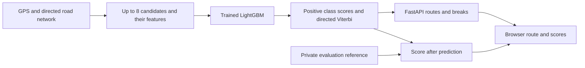

# PathSnap

PathSnap matches noisy GPS traces to directed road arcs. It generates a short candidate list for each observation, scores it with the shipped Optuna-tuned LightGBM classifier, and uses HMM/Viterbi to recover connected route segments. FastAPI serves predictions and a same-origin browser evaluator.



## Run the demo

On Mac, use Python 3.12 and Homebrew's OpenMP runtime for LightGBM. Install them if needed.

```sh
brew install python@3.12 libomp
python3.12 -m venv .venv-demo
.venv-demo/bin/python -m pip install -r requirements.txt
./start_demo.sh
```

The script verifies the pinned versions, loads the real model, checks network and evaluator availability, and prints the Windows URL. It binds Uvicorn to IPv4 `0.0.0.0`, permits HTTP requests from the selected private subnet and loopback, and shows access logs in the foreground. If port 8000 is busy, the default launcher reports its PID and tries 8001. Ctrl+C in the hosting terminal stops the server.

On the Windows client, join the same Wi-Fi and open the printed `http://<mac-lan-ip>:<port>/ui` address. Select **00000052** and click **Run prediction**. Windows only needs a browser for the demo. For optional local Windows API development:

```powershell
py -3.12 -m venv .venv-demo
.venv-demo\Scripts\python.exe -m pip install -r requirements.txt
$env:PATHSNAP_EVALUATOR_DIR = "data/student_test"
.venv-demo\Scripts\python.exe -m uvicorn src.api.main:app --host 127.0.0.1 --port 8000
```

Manual local API startup on macOS:

```sh
PATHSNAP_EVALUATOR_DIR=data/student_test .venv-demo/bin/python -m uvicorn src.api.main:app --host 127.0.0.1 --port 8000
```

Use the demo launcher when sharing access over Wi-Fi. The demo operator confirmed the Windows browser opened the page and completed prediction. Installing a backend on Windows was outside this rehearsal. [Two-laptop guide](DEMO_GUIDE.md)

## Configuration and model

The tracked `model_artifacts/` directory includes `final_model.joblib`, `feature_columns.json`, `config.json`, the handoff, and the model requirements. Set `PATHSNAP_MODEL_DIR` to the directory containing all three matching inference files to change the bundle. Use an export you trust and its matching environment versions. The model was exported on Windows with Python 3.12.7. The tested Mac runtime is Python 3.12.13 with LightGBM 4.7.0 and scikit-learn 1.9.1. `requirements.txt` combines the backend pins and the model's pinned runtime. `requirements-analysis.txt` adds optional benchmarking and training tools.

| Variable | Default |
| --- | --- |
| `PATHSNAP_MODEL_DIR` | `model_artifacts` |
| `PATHSNAP_NETWORK_DIR` | `data/train` for direct predictions and readiness |
| `PATHSNAP_READINESS_NETWORK_ID` | `00000001` inside the default network directory |
| `PATHSNAP_EVALUATOR_DIR` | `data/student_test` when using the demo launcher. Set it explicitly for manual Uvicorn. |
| `PATHSNAP_LAN_INTERFACE` | Launcher tries active private `en0` and then `en1` |
| `PATHSNAP_PORT` | Launcher tries 8000 and then 8001 unless explicitly set |

Relative data and model paths resolve from the repository root. Export settings in your shell. `.env.example` lists the available variables.

## Project structure and responsibilities

| Owner | Components |
| --- | --- |
| Samarth | `src/api/`, deployment scripts, integration and evaluator |
| Pruthviraj | `data_exploration/code/` dataset inspection, candidate generation and features |
| Reyansh | `model_experiments/`, trained model export and model metadata |
| Raksha | `hmm/`, decoder tests, benchmark and HMM comparison |

`frontend/evaluator.html` is served by FastAPI. `data/train/` has 80 trips. `data/student_test/` has ten evaluation trips. Each trip has a `.track` trajectory, `.nodes` coordinates, `.arcs` directed edge records, and a reference `.route`. The feature generator works with the first three files. Evaluation reference routes are read on the server after decoding. They are reserved from model training, tuning, and prediction selection. Generated labeled feature tables under `full_features/` remain local.

## Model and decoder

The feature generator projects each observation onto nearby arcs and retains up to eight candidates. It retains trip, GPS row, and arc IDs separately. The model uses the 13 ordered numeric features in `feature_columns.json`, with the export's float32 dtype. The training pipeline uses median imputation and LightGBM, with Optuna tuning selected by trip-grouped cross-validation on the 80 training trips. The recorded export reports 1,667,336 training candidate rows. The adapter checks feature order, determines the positive column from the loaded model's `classes_`, and validates outputs before grouping probabilities by GPS row.

Viterbi uses the log of each positive LightGBM probability as its emission and compares directed network travel distance with observed GPS movement. The offset on each state is measured in meters from the source of its directed arc. The decoder preserves unmatched rows and reports breaks for gaps and unreachable transitions. The distance-only maps in `docs/maps/` are separate benchmarks.

## API

| Method and path | Purpose |
| --- | --- |
| `GET /health` | Service and component status |
| `GET /ready` | Inference readiness, with 503 when a required component is missing |
| `GET /evaluation/trips` | Available IDs in the configured evaluator dataset |
| `POST /evaluation/{trip_id}` | Predict the trip and return GPS, route geometry and optional aggregate evaluation scores |
| `POST /predict` | Predict from a network ID and ordered GPS observations |
| `GET /ui` | Same-origin evaluator |
| `GET /docs` | Interactive OpenAPI contract |

```sh
curl http://127.0.0.1:8000/ready
curl http://127.0.0.1:8000/evaluation/trips
curl -X POST http://127.0.0.1:8000/evaluation/00000052
```

Replace the port with the one printed at startup. [Direct prediction request and API errors](API_DOCUMENTATION.md)

## Verification and limitations

```sh
.venv-demo/bin/python -m pytest -q -rs
```

Install `folium` to exercise the optional benchmark-input regression. The real-model test copies a student trip without its reference, checks that each actual score reaches the corresponding HMM state, then reruns with reference scoring enabled and verifies it occurs after decoding.

The live Mac browser rendered trip `00000052` over the Mac LAN address. It used **2,096 classifier scores** for **262 GPS observations**, with **262 matches**, **1 directed segment**, and **no breaks**. Point reference agreement was **96.2%** and directed arc-set F1 was **68.9%** for this one trip. Point agreement compares the selected arc with the nearest reference arc for each GPS row; route F1 combines precision and recall of unique directed arcs. Long trips and large networks can take longer. The Windows laptop also opened the LAN demo and ran the prediction, as confirmed by the operator. The organiser's reserved trips remain to be checked. [Live metrics](demo_evidence/live_evaluation.json) · [Rendered route](demo_evidence/mac-browser-route.jpg) · [Team walkthrough](TEAM_WALKTHROUGH.md) · [Source inventory](INTEGRATION_INVENTORY.md)
